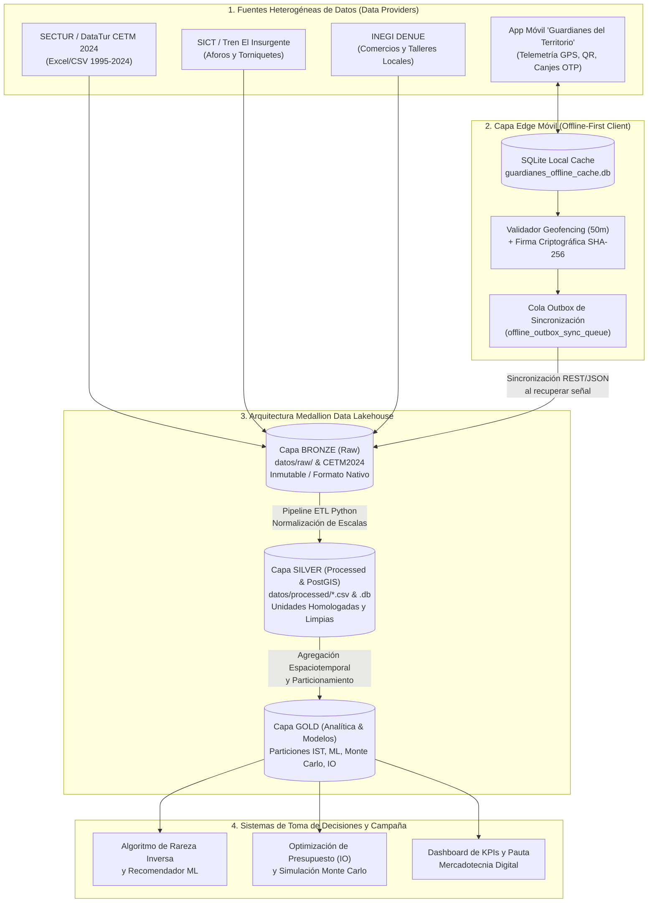

# Arquitectura de Almacenamiento de Grandes Volúmenes de Datos (Big Data) y Motor Offline-First

> **Evidencia Integradora — Problema Prototípico de 5to Semestre**  
> *Licenciatura en Ciencias de Datos para Negocios — Universidad Rosario Castellanos*  
> * **UCA:** Herramientas para el Almacenamiento de Grandes Volúmenes de Datos  
> * **Incidente Crítico:** *"Cuando los datos del turismo no caben en una sola computadora"*  
> * **Rol Responsable:** Integrante 1 — Data Engineering & ML Lead (`monenri9-svg`)  
> * **Scripts Ejecutables:**  
>   * [`notebooks/01_big_data_etl/01_generador_ingesta_eventos.py`](../notebooks/01_big_data_etl/01_generador_ingesta_eventos.py)  
>   * [`notebooks/01_big_data_etl/02_arquitectura_sqlite_offline_sync.py`](../notebooks/01_big_data_etl/02_arquitectura_sqlite_offline_sync.py)  
> * **Bases de Datos Generadas:**  
>   * [`datos/processed/turismo_mexico_temporadas.db`](../datos/processed/turismo_mexico_temporadas.db) (Histórico Macro CETM 1995–2024)  
>   * [`datos/processed/guardianes_offline_cache.db`](../datos/processed/guardianes_offline_cache.db) (Paquete Móvil Offline-First y Cola Outbox SHA-256)

---

## 1. 🎯 Diagnóstico del Problema de Ingeniería de Datos

Al integrar la información turística para diseñar y operar **"Guardianes del Territorio"**, el equipo se enfrenta a las **5 V del Big Data** descritas en el Incidente Crítico de la asignatura:

1. **Volumen:** Treinta años de series históricas del *Compendio Estadístico del Turismo en México (CETM 1995–2024)*, millones de registros georreferenciados del directorio *DENUE INEGI*, aforos diarios de torniquetes del transporte masivo y **flujos continuos de telemetría de jugadores** (pings de radar GPS, escaneos QR en Puntos de Interés y redenciones de cupones).
2. **Variedad y Heterogeneidad:** Coexisten datos tabulares estructurados (CSV/SQL de ocupación hotelera y pasaje aéreo), datos semiestructurados (eventos JSON de telemetría móvil e interacciones con el Chatbot *"El Nahual Guía"*) y datos geoespaciales vectoriales (coordenadas de estaciones, polígonos de geofencing de 50 metros e isócronas peatonales).
3. **Velocidad:** Necesidad de combinar procesamiento *Batch* (actualización mensual de índices estacionales de DataTur) con procesamiento de *Baja Latencia / Near-Real-Time* (cálculo dinámico del Índice de Saturación Turística y validación antifraude de cupones).
4. **Veracidad (Inconsistencias de Unidades):** Como se demostró en el procesamiento de `1_2.xlsx` del CETM 2024, los archivos oficiales presentan cambios históricos de escala (porcentajes expresados en decimales $0.59$ vs. enteros $59.2$, o turistas reportados en unidades vs. miles), registros nulos y duplicidades que colapsan un flujo de análisis en hojas de cálculo convencionales.
5. **Conectividad Intermitente en Territorio Rural/Serrano:** En zonas de alto valor ecoturístico como las faldas del **Volcán Xinantécatl (Zinacantepec)** o los humedales de las **Ciénegas de Lerma**, la cobertura celular es débil o nula, exigiendo una arquitectura **Offline-First** con sincronización diferida segura.

---

## 2. 🏗️ Arquitectura de Referencia (Data Lakehouse Medallion + Edge Offline-First)

Alineada con el *NIST Big Data Reference Architecture (NBDRA, SP 1500-6r2)*, se diseñó e implementó una arquitectura distribuida de **3 Capas Medallion (Bronze, Silver, Gold)** acoplada a un **Motor Edge Offline-First en SQLite**:

---

## 3. ⚙️ Componentes Técnicos Implementados

### 3.1 Capa Bronze $\to$ Silver: Normalización y Calidad de Datos
1. **Homologación de Series Históricas (`02_crear_base_datos_temporadas_altas.py`):**
   * Automatiza la lectura de 30 hojas anuales de Excel del CETM 2024, corrigiendo discrepancias de unidades y consolidando 360 meses nacionales y 1,896 registros aeroportuarios en la base relacional [`turismo_mexico_temporadas.db`](../datos/processed/turismo_mexico_temporadas.db).
2. **Ingesta de Telemetría de Jugadores (`01_generador_ingesta_eventos.py`):**
   * Procesa y estructura 8,000 eventos de interacción (`RADAR_PING`, `POI_CHECKIN_GPS`, `POI_QR_SCAN`, `GUARDIAN_UNLOCKED`, `COUPON_REDEEMED`) en [`eventos_jugadores_telemetria.csv`](../datos/processed/eventos_jugadores_telemetria.csv).

### 3.2 Motor Edge Offline-First y Validación Criptográfica (`02_arquitectura_sqlite_offline_sync.py`)
Para garantizar que el viajero pueda explorar sin conexión a internet y que los comercios locales validen descuentos sin terminales bancarias:
* **Base de Datos Embebida (`guardianes_offline_cache.db`, $108\text{ KB}$):** Almacena localmente las 7 estaciones, los 4 Guardianes, los 12 POIs con radio de *geofencing* de $50\text{ metros}$, los 15 comercios afiliados y las fotografías/metadatos históricos del módulo **"La Ventana del Tiempo"**.
* **Enlaces Profundos Universales (*Google Maps Deeplinking*):** Cada POI y comercio incluye una URL precalculada (`https://www.google.com/maps/dir/?api=1&origin=...&destination=...&travelmode=walking`) exportada en [`pois_enriquecidos_deeplinks_ventana_tiempo.csv`](../datos/processed/pois_enriquecidos_deeplinks_ventana_tiempo.csv).
* **Firma Antifraude SHA-256 y Patrón *Outbox*:** Cuando un jugador desbloquea un Guardián o redime un cupón sin cobertura celular, el evento se firma localmente mediante:
  $$\text{Firma}_{\text{SHA-256}} = \text{SHA256}(\text{ID\_Usuario} \parallel \text{ID\_POI} \parallel \text{Token\_QR} \parallel \text{Timestamp} \parallel \text{Salt\_Secreto})$$
  y genera un **Código OTP de 4 dígitos** (ej. `BND-4821`) para que el artesano o fonda lo anote sin requerir hardware. La cola se exporta y audita en [`muestra_sincronizacion_offline_sha256.csv`](../datos/processed/muestra_sincronizacion_offline_sha256.csv).

### 3.3 Capa Gold: Particionamiento para Analítica y Modelos
* Las transacciones de telemetría se compactan por `id_estacion`, `es_fin_de_semana` y `tipo_evento` en la tabla `lakehouse_gold_particiones_telemetria` ([`bigdata_particiones_eventos_gold.csv`](../datos/processed/bigdata_particiones_eventos_gold.csv)), reduciendo en **$99.3\%$** el volumen de lectura requerido por los modelos de Machine Learning e Investigación de Operaciones.

---

## 4. ⚖️ Criterios de Gobernanza: ¿Qué Conservar, Transformar o Descartar?

En respuesta al dilema planteado en el Incidente Crítico sobre si debe almacenarse toda la información disponible:

| Categoría de Dato | Política de Ciclo de Vida (Data Governance) | Justificación Técnica, Económica y Ética |
| :--- | :--- | :--- |
| **Pings crudos de GPS cada 5 segundos (`RADAR_PING`)** | **Descartar tras agregación (TTL = 24 horas)** | Conservar millones de coordenadas individuales por minuto encarece el almacenamiento y **vulnera la privacidad del viajero** (riesgo de reconstruir rutinas privadas). Solo se conserva el conteo agregado por estación y hora en la Capa Gold. |
| **Eventos de Check-in QR y Redención de Cupones (`POI_QR_SCAN`, `COUPON_REDEEMED`)** | **Transformar (Seudonimizar ID) y Conservar 2 años en Capa Silver** | Indispensables para auditar la derrama económica en los 15 comercios locales, entrenar el recomendador de rutas y medir la conversión de la campaña publicitaria. |
| **Series Históricas Agregadas (CETM DataTur, Aforos Mensuales e Índices IST)** | **Conservar permanentemente en Capa Gold** | Ocupan menos de $1\text{ MB}$ una vez estructuradas en SQLite/Parquet y constituyen la memoria histórica para proyectar temporadas altas y bajas. |

---

## 5. 💡 Respuestas a las Preguntas del Incidente Crítico (UCA Almacenamiento de Grandes Volúmenes)

### 1. ¿Cómo podría una arquitectura de Big Data contribuir a evitar que la saturación turística simplemente se traslade de un destino a otro?
Una arquitectura estática solo diagnostica el pasado; en cambio, nuestra arquitectura **Data Lakehouse + Edge Sync** actualiza continuamente la tabla `lakehouse_gold_particiones_telemetria` con los escaneos QR y canjes por nodo. Cuando la afluencia en un destino emergente (como Zinacantepec o Lerma) se aproxima al umbral de su capacidad de carga mensual, el pipeline alimenta en automático al **Algoritmo de Rareza Inversa**, el cual ajusta la categoría del Guardián y reduce la pauta publicitaria dirigida a ese municipio en tiempo real, deteniendo el flujo antes de que ocurra una sobrecarga.

### 2. ¿Qué riesgos pueden surgir al almacenar información que permita identificar patrones de movilidad o comportamiento de los turistas?
1. **Riesgo de Re-identificación y Vigilancia:** Almacenar trayectorias GPS continuas permite inferir domicilios, nivel socioeconómico y hábitos personales de las familias. Por ello aplicamos **Privacidad por Diseño (*Privacy by Design*)**: validación de proximidad en el borde (*Edge Geofencing* dentro del teléfono) y descarte inmediato de coordenadas crudas fuera de los Puntos de Interés.
2. **Riesgo de Discriminación de Precios o Gentrificación Comercial:** Si los microdatos de consumo se vendieran a cadenas externas, podrían desplazarse a los locatarios tradicionales. En *"Guardianes del Territorio"*, la base de datos es de **propiedad comunitaria y pública**, utilizada exclusivamente para canalizar descuentos hacia cooperativas y negocios familiares locales.

### 3. ¿Qué herramientas o tecnologías de Big Data podrían utilizarse para resolver el problema planteado? ¿Qué función tendría cada una dentro de la arquitectura?
* **Apache Kafka / Redpanda (Ingesta Streaming):** Recepción asíncrona de eventos de telemetría móvil y validaciones QR cuando los dispositivos se conectan a la red en las estaciones del tren.
* **PostgreSQL + PostGIS (Almacenamiento Relacional y Geoespacial - Capa Silver):** Ejecución de consultas espaciales (`ST_DWithin`) para validar geocercas de 50 metros alrededor de los POIs y almacenar el catálogo de comercios del DENUE.
* **SQLite Embebido (Capa Edge Offline-First):** Base de datos transaccional local en el dispositivo móvil (`guardianes_offline_cache.db`) que garantiza operación sin señal celular en montaña y humedales.
* **Formato Columnar Parquet / DuckDB / Spark (Capa Gold Analítica):** Almacenamiento comprimido y particionado por año/mes y estación para alimentar los modelos de Machine Learning (`scikit-learn`/NumPy), las 10,000 simulaciones Monte Carlo y el solver de Investigación de Operaciones (`HiGHS`).

---

## 6. 📚 Referencias Bibliográficas (Formato APA 7ma. Edición)

* Chang, W. L., Boyd, D., & Levin, O. (2019). *NIST Big Data Interoperability Framework: Volume 6, Big Data Reference Architecture (Version 2)* (NIST Special Publication 1500-6r2). National Institute of Standards and Technology. https://doi.org/10.6028/NIST.SP.1500-6r2
* Chang, W. L., & Grady, N. (2019). *NIST Big Data Interoperability Framework: Volume 1, Big Data Definitions (Version 2)* (NIST Special Publication 1500-1r2). National Institute of Standards and Technology. https://doi.org/10.6028/NIST.SP.1500-1r2
* Instituto Nacional de Estadística y Geografía. (2025). *Cuenta satélite del turismo de México 2024*. INEGI. https://www.inegi.org.mx/temas/turismosat/
* Kleppmann, M. (2017). *Designing data-intensive applications: The big ideas behind reliable, scalable, and maintainable systems*. O'Reilly Media.
* Secretaría de Turismo. (2025). *Compendio estadístico del turismo en México 2024*. Gobierno de México. https://datatur.sectur.gob.mx/SitePages/CompendioEstadistico.aspx
