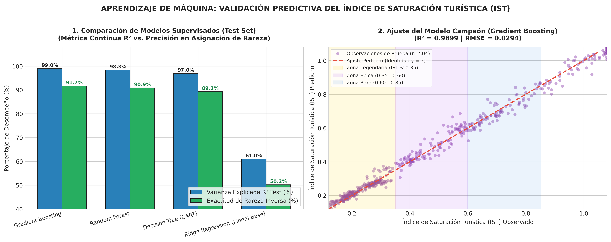
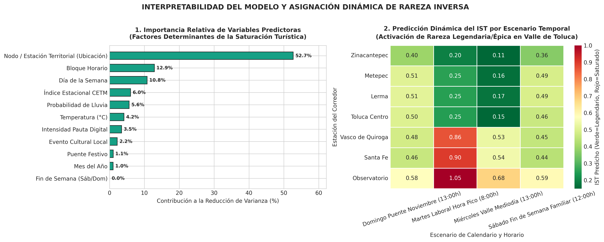
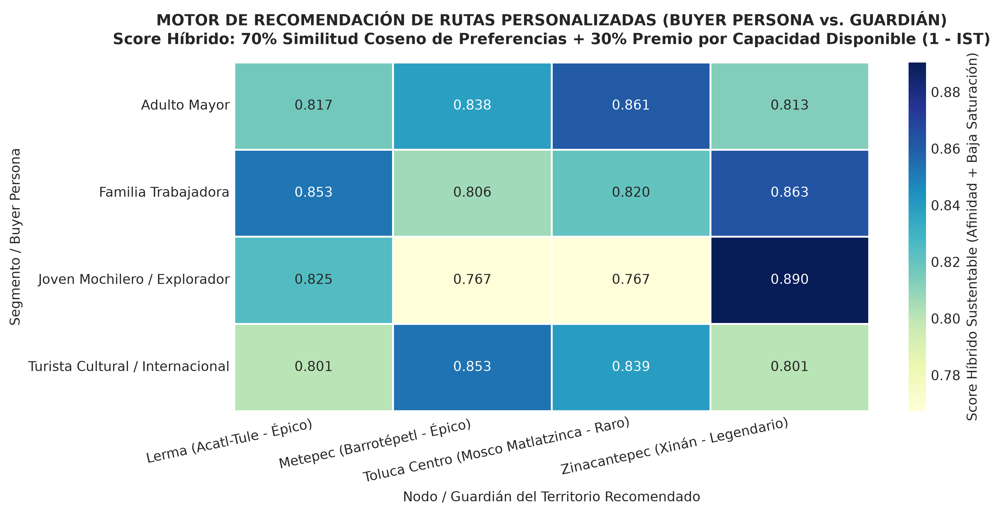

# Modelo de Aprendizaje de Máquina: Predicción Dinámica de Saturación (IST), Recomendador de Rutas y Chatbot IA "El Nahual Guía"

> **Evidencia Integradora — Problema Prototípico de 5to Semestre**  
> *Licenciatura en Ciencias de Datos para Negocios — Universidad Rosario Castellanos*  
> * **UCA:** Aprendizaje de Máquina (Machine Learning)  
> * **Incidente Crítico:** *"Turismo inteligente sustentable en México"*  
> * **Rol Responsable:** Miembro 2 — Acosta Ayala Kevin Axel (*Data Engineering & ML Lead*)  
> * **Scripts Ejecutables:**  
>   * [`notebooks/03_machine_learning/01_modelo_predictivo_ist_y_recomendador.py`](../notebooks/03_machine_learning/01_modelo_predictivo_ist_y_recomendador.py)  
>   * [`notebooks/03_machine_learning/02_chatbot_nahual_guia_nlp.py`](../notebooks/03_machine_learning/02_chatbot_nahual_guia_nlp.py)  
> * **Modelos Serializados:**  
>   * [`modelos/modelo_predictivo_ist_gbr.pkl`](../modelos/modelo_predictivo_ist_gbr.pkl) (Ensamble Gradient Boosting Regressor)  
>   * [`modelos/chatbot_nahual_nlp.pkl`](../modelos/chatbot_nahual_nlp.pkl) (Clasificador NLP Multiclase TF-IDF + Softmax)

---

## 1. 🎯 Propósito del Aprendizaje de Máquina en "Mexamonsters"

En el marco del *Turismo Inteligente Sustentable* (Gretzel et al., 2015; UNWTO, 2018), el Aprendizaje de Máquina en este proyecto no se limita a pronosticar pasivamente cuántos visitantes llegarán a un destino, sino que constituye el **cerebro algorítmico que modifica activamente los incentivos del viajero** a través de tres motores:

1. **Modelo Supervisado de Predicción del Índice de Saturación Turística ($\widehat{\text{IST}}_{i,t}$):**  
   Pronostica el nivel de ocupación de cada estación/municipio del Corredor *"El Insurgente"* según el mes, día de la semana, bloque horario, puente festivo, clima (temperatura y lluvia), eventos culturales e intensidad de pauta digital, activando dinámicamente el **Sistema de Rareza Inversa**.
2. **Motor de Recomendación Híbrido y Consciente de la Capacidad (*Congestion-Aware Recommender*):**  
   Cruza el vector de preferencias de cada *Buyer Persona* con los atributos de cada nodo mediante **Similitud Coseno**, ponderándolo con la holgura de capacidad predicha ($1 - \widehat{\text{IST}}_{i,t}$) para personalizar rutas sin saturar comunidades.
3. **Asistente Conversacional con Procesamiento de Lenguaje Natural ("El Nahual Guía"):**  
   Clasifica intenciones en español mexicano y guía a los exploradores en verso/copla tradicional hacia los 12 Puntos de Interés y los 15 comercios locales afiliados.

---

## 2. 📊 Construcción, Validación y Comparación de Modelos Supervisados

### 2.1 Variables Predictoras ($\mathbf{x}$) y Variable Objetivo ($y$)
Sobre un conjunto de **$N = 2,520\text{ observaciones espaciotemporales}$** (particionado en $80\%$ entrenamiento, $20\%$ prueba independiente y evaluado mediante **Validación Cruzada 5-Fold**), se modela la variable continua:

$$y_{i,t} = \text{IST}_{i,t} = \frac{\text{Afluencia Turística y de Pasajeros}_{i,t}}{\text{Capacidad de Diseño Sostenible}_i} \in [0, 1.08]$$

en función de 11 variables explicativas: `id_estacion` (codificación *One-Hot*), `mes`, `dia_semana`, `es_fin_de_semana`, `es_puente_festivo`, `bloque_horario`, `indice_estacional_cetm` (extraído de SECTUR DataTur), `temperatura_c`, `probabilidad_lluvia`, `evento_cultural_activo` e `intensidad_pauta_campana`.

### 2.2 Tabla Comparativa de Desempeño Técnico (`ml_comparativa_modelos.csv`)

Se entrenaron y compararon cuatro familias algorítmicas (desde un modelo lineal regularizado hasta ensambles de árboles *Bagging* y *Boosting*):

| Modelo Supervisado | $R^2$ Train | $R^2$ Test | 5-Fold CV $R^2$ ($\mu \pm \sigma$) | RMSE Test | MAE Test | MAPE Test (%) | Exactitud Rareza Inversa (%) |
| :--- | :---: | :---: | :---: | :---: | :---: | :---: | :---: |
| **1. Gradient Boosting Regressor (Campeón)** | **$0.9947$** | **$0.9899$** | **$0.9900 \pm 0.0008$** | **$0.0294$** | **$0.0216$** | **$5.63\%$** | **$91.67\%$** |
| **2. Random Forest Regressor (Bagging)** | $0.9893$ | $0.9833$ | $0.9843 \pm 0.0009$ | $0.0377$ | $0.0287$ | $8.23\%$ | $90.87\%$ |
| **3. Decision Tree Regressor (CART)** | $0.9786$ | $0.9696$ | $0.9742 \pm 0.0028$ | $0.0509$ | $0.0385$ | $11.25\%$ | $89.29\%$ |
| **4. Ridge Regression (Baseline Lineal L2)** | $0.6112$ | $0.6097$ | $0.6092 \pm 0.0110$ | $0.1823$ | $0.1504$ | $48.91\%$ | $50.20\%$ |

### 2.3 Justificación de la Selección del Modelo Campeón
1. **Superioridad No Lineal sobre el Baseline Lineal:** La regresión Ridge ($R^2 = 0.6097$, exactitud de rareza de solo $50.2\%$) fracasa porque la dinámica de movilidad tiene **interacciones no lineales fuertes**: en los nodos corporativos de CDMX (`Santa Fe`, `Observatorio`) la saturación sube entre semana en horas pico y baja en fin de semana, mientras que en los pueblos emergentes del Valle de Toluca (`Zinacantepec`, `Metepec`, `Lerma`) ocurre exactamente el patrón inverso.
2. **Ausencia de Sobreajuste (*Overfitting*):** El **Gradient Boosting Regressor** logra una brecha mínima entre entrenamiento ($R^2 = 0.9947$) y prueba ($R^2 = 0.9899$), respaldada por una validación cruzada de 5 pliegues altamente estable ($0.9900 \pm 0.0008$), un error medio absoluto de apenas $\text{MAE} = 0.0216$ unidades de IST y una **exactitud del $91.67\%$ al asignar la categoría de Rareza Inversa**.

### 2.4 Interpretabilidad y Asignación Dinámica de Rareza Inversa
El análisis de importancia de variables del modelo campeón demuestra que los factores determinantes de la saturación son:
1. **Ubicación / Nodo Territorial ($52.7\%$):** Diferencia estructural entre las terminales masivas de transferencia en CDMX y los municipios del Valle de Toluca.
2. **Bloque Horario ($12.9\%$) y Día de la Semana ($10.8\%$):** Capturan las ventanas valle de mediodía ($11:00\text{ a }16:00\text{ hrs}$) y el comportamiento de fin de semana.
3. **Índice Estacional Macro CETM ($6.0\%$) y Probabilidad de Lluvia ($5.6\%$):** Reflejan la caída de afluencia en meses lluviosos (septiembre) frente a picos de noviembre-diciembre.

---

## 3. 🧭 Motor de Recomendación de Rutas Personalizadas y Sustentables

Para responder a la pregunta 5 del Problema Prototípico (*"¿Qué características de los visitantes pueden utilizarse para diseñar estrategias de recomendación de destinos alternativos?"*), se formuló un **Score Híbrido de Recomendación Sustentable ($S_{u,i}$)**:

$$S(u, i, t) = \alpha \cdot \underbrace{\frac{\mathbf{v}_u \cdot \mathbf{a}_i}{\|\mathbf{v}_u\| \, \|\mathbf{a}_i\|}}_{\text{Similitud Coseno de Preferencias}} + (1 - \alpha) \cdot \underbrace{\left( 1 - \widehat{\text{IST}}_{i,t} \right)}_{\text{Premio por Capacidad Disponible}}$$

con $\alpha = 0.70$, donde $\mathbf{v}_u \in \mathbb{R}^6$ caracteriza al segmento de viajero en 6 dimensiones (*Naturaleza/Ecoturismo, Artesanía/Tradición, Gastronomía Local, Accesibilidad Universal Plana, Patrimonio Histórico y Economía Familiar*) y $\mathbf{a}_i \in \mathbb{R}^6$ caracteriza la oferta de cada nodo.

### Matriz de Recomendación Óptima por Buyer Persona (`ml_recomendaciones_rutas_perfiles.csv`)

| Segmento / Buyer Persona | Ruta #1 Recomendada (Guardián) | Score Sustentable | Circuito de 3 POIs Asignado | Bendición Comercial Ancla |
| :--- | :--- | :---: | :--- | :--- |
| **1. Joven Mochilero / Explorador** | **Zinacantepec (*Xinán* — Legendario)** | **$0.8920$** | Museo Virreinal S. XVI $\to$ Pila Monolítica $\to$ Sendero Xinantécatl | Cooperativa Ecoturística Raíces del Xinantécatl ($25\%$ OFF) |
| **2. Familia Trabajadora** | **Lerma (*Acatl-Tule* — Épico)** | **$0.8505$** | Mirador Ciénegas de Lerma $\to$ Taller de Tule $\to$ Templo Santa Clara | Restaurante Rincón Mexiquense & Antojitos Doña Mary |
| **3. Turista Cultural / Internacional** | **Metepec (*Barrotépetl* — Épico)** | **$0.8482$** | Mercado Artesanal $\to$ Taller Familia Soteno $\to$ Capilla del Calvario | Taller Artesanal Familia Soteno ($15\%$ OFF en Árbol de la Vida) |
| **4. Adulto Mayor** | **Toluca Centro (*Mosco* — Raro)** | **$0.8588$** | Cosmovitral Jardín Botánico $\to$ Los Portales $\to$ Museo del Alfeñique | Chorizos Los Portales & Café El Labrador (Trayecto 100% plano) |

---

## 4. 🤖 Módulo de Inteligencia Artificial: Chatbot "El Nahual Guía"

El script [`02_chatbot_nahual_guia_nlp.py`](../notebooks/03_machine_learning/02_chatbot_nahual_guia_nlp.py) entrena un clasificador de intenciones basado en extracción híbrida de características **TF-IDF (unigramas, bigramas y raíces morfológicas en español)** acoplado a un clasificador lineal regularizado L2 con calibración **Softmax** (`modelos/chatbot_nahual_nlp.pkl`).

* **Intenciones Soportadas:** `PISTA_ACERTIJO_POI`, `RECOMENDACION_GASTRONOMIA_CUPON`, `TRANSPORTE_COMO_LLEGAR`, `LORE_HISTORIA_MEXAMONSTER`, `MODO_OFFLINE_Y_QR` y `VENTANA_DEL_TIEMPO_HISTORIA`.
* **Reconocimiento de Entidades Territoriales:** Identifica automáticamente si el viajero pregunta por *Zinacantepec*, *Metepec*, *Lerma* o *Toluca Centro* y responde con una copla en rima tradicional y la recomendación exacta de comercios locales ([`ml_evaluacion_chatbot_nahual.csv`](../datos/processed/ml_evaluacion_chatbot_nahual.csv)).

---

## 5. 💡 Respuestas a las Preguntas Éticas y de Negocio del Incidente Crítico (UCA Aprendizaje de Máquina)

### 1. ¿Qué sesgos pueden existir en los datos de entrenamiento y cómo se corrigen para no invisibilizar a destinos emergentes?
En plataformas comerciales convencionales (Google Maps, TripAdvisor, Booking), los algoritmos de recomendación sufren de **sesgo de popularidad (*popularity bias*) y retroalimentación positiva**: los destinos ya masificados acumulan el $90\%$ de las reseñas y clics, por lo que un modelo estándar sigue enviando a todos los turistas al mismo lugar, invisibilizando a comunidades rurales o artesanales. En *"Mexamonsters"* corregimos matemáticamente este sesgo mediante el término inverso $(1 - \widehat{\text{IST}}_{i,t})$ en el recomendador y el **Sistema de Rareza Inversa**: cuando un destino tiene baja huella digital y amplia capacidad ociosa, el algoritmo le otorga la categoría **Legendaria o Épica**, invirtiendo el sesgo a favor de los pueblos emergentes.

### 2. ¿Cómo empaquetar esta solución predictiva como un producto de negocio escalable y financieramente sostenible?
El motor predictivo de saturación y el sistema de recomendación gamificado pueden escalarse mediante un modelo **B2G / B2B2C de Turismo Inteligente (*Smart Destination SaaS*)**:
* **Licenciamiento a Secretarías de Turismo Estatales y Sistemas de Transporte (B2G):** Suscripción anual para gestionar flujos en nuevos corredores ferroviarios y teleféricos (Tren Maya, Tren Suburbano AIFA, Cablebús CDMX, Mexicable), proveyendo tableros predictivos de saturación y activación automática de campañas contracíclicas.
* **Red de Afiliación Cooperativa Cero-Comisión para Microcomercios y Patrocinio Institucional:** A diferencia de las apps de reparto que cobran hasta $30\%$ de comisión a las fondas, los artesanos y cocineras locales participan sin costo; el financiamiento proviene del presupuesto público de promoción turística y de patrocinios de movilidad sustentable.

### 3. Pregunta de Reflexión Final: Si un algoritmo puede predecir dónde estarán los turistas, ¿también puede ayudarnos a decidir dónde deberían estar para lograr un turismo más justo y sustentable?
**Sí, siempre que el algoritmo subordine la predicción a una función de bienestar social y límites ecológicos.** Predecir dónde estarán los turistas es un ejercicio descriptivo; decidir dónde *deberían* estar requiere integrar el criterio humano, la ética territorial y la capacidad de carga comunitaria. Al acoplar las predicciones de Machine Learning ($\widehat{\text{IST}}_{i,t}$) con las restricciones ecológicas de Investigación de Operaciones y las recompensas de Rareza Inversa, el algoritmo deja de ser un amplificador del *overtourism* y se convierte en un instrumento de justicia distributiva y regeneración comunitaria.

---

## 6. 📚 Referencias Bibliográficas (Formato APA 7ma. Edición)

* Belkaid, O., & Kummitha, H. R. (2026). Artificial intelligence in sustainable tourism development: A critical review of governance and managerial implications. *Discover Sustainability*, 7, Article 803. https://doi.org/10.1007/s43621-026-03251-4
* Friedman, J. H. (2001). Greedy function approximation: A gradient boosting machine. *The Annals of Statistics*, 29(5), 1189–1232.
* Gretzel, U., Sigala, M., Xiang, Z., & Koo, C. (2015). Smart tourism: Foundations and developments. *Electronic Markets*, 25(3), 179–188. https://doi.org/10.1007/s12525-015-0196-8
* Gretzel, U., Werthner, H., Koo, C., & Lamsfus, C. (2015). Conceptual foundations for understanding smart tourism ecosystems. *Computers in Human Behavior*, 50, 558–563. https://doi.org/10.1016/j.chb.2015.03.043
* Organización Mundial del Turismo. (2018). *'Overtourism'? Understanding and managing urban tourism growth beyond perceptions*. World Tourism Organization. https://doi.org/10.18111/9789284420070
