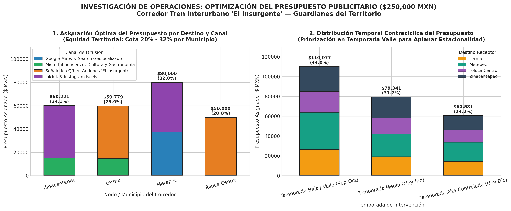
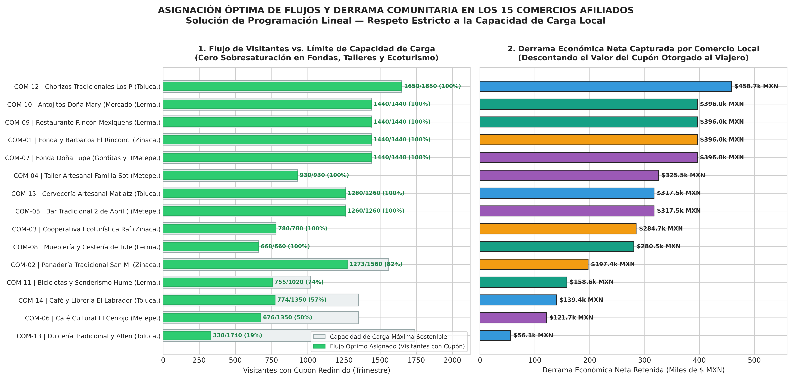
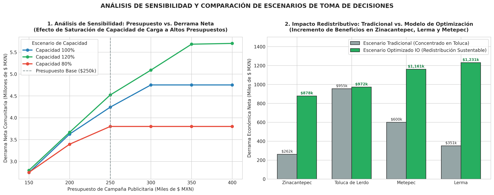

# Modelo de Investigación de Operaciones: Optimización de Flujos Turísticos, Presupuesto Publicitario y Capacidad de Carga Comunitaria

> **Evidencia Integradora — Problema Prototípico de 5to Semestre**  
> *Licenciatura en Ciencias de Datos para Negocios — Universidad Rosario Castellanos*  
> * **UCA:** Investigación de Operaciones  
> * **Incidente Crítico:** *"Optimización de los flujos turísticos para un desarrollo sustentable"*  
> * **Rol Responsable:** Integrante 2 — Operations Research & Quants (`monenri9-svg`)  
> * **Script Ejecutable:** [`notebooks/05_optimizacion_io/01_optimizacion_presupuesto_y_flujos.py`](../notebooks/05_optimizacion_io/01_optimizacion_presupuesto_y_flujos.py)

---

## 1. 🎯 Planteamiento del Problema de Optimización

En el diseño de la campaña publicitaria inteligente **"Guardianes del Territorio"** sobre el corredor del Tren Interurbano *"El Insurgente"* (Zinacantepec, Toluca Centro, Metepec y Lerma), las decisiones de asignación de recursos enfrentan objetivos en tensión:
1. **Eficiencia Económica vs. Equidad Territorial:** Concentrar el presupuesto publicitario en el nodo urbano consolidado (Toluca Centro) o en los meses de Temporada Alta presenta costos de adquisición (CAC) nominalmente menores en el corto plazo, pero reproduce la desigualdad territorial y satura un solo punto.
2. **Maximización de Derrama vs. Capacidad de Carga Ecosistémica y Comunitaria:** Las cooperativas ecoturísticas del Nevado de Toluca (Zinacantepec), los humedales de las Ciénegas de Lerma (Sitio Ramsar) y los talleres familiares de barro y tule tienen **límites físicos estrictos de atención mensual**. Rebasar dicha capacidad degradaría el ecosistema, saturaría a las fondas locales y deterioraría la experiencia del visitante.
3. **Inclusión Sociodemográfica de Medios:** Depender exclusivamente de pauta en redes sociales excluiría a **Adultos Mayores** y **Familias Trabajadoras** que utilizan el transporte público físico.

Para resolver simultáneamente estas tensiones, se formula un **Modelo de Programación Lineal / Entera Mixta (LP/MILP) Multiobjetivo Acoplado en Dos Niveles**, resuelto mediante el algoritmo **HiGHS** (`scipy.optimize.linprog`).

---

## 2. 📐 Formulación Matemática Rigurosa

### 2.1 Conjuntos e Índices

* **$I = \{\text{EST-01}, \text{EST-02}, \text{EST-03}, \text{EST-04}\}$:** Conjunto de nodos/municipios receptores en el Corredor Valle de Toluca:
  * $\text{EST-01}$: Zinacantepec (*Xinán* — Guardián Legendario, $\text{IST} = 0.212$).
  * $\text{EST-02}$: Toluca Centro (*Mosco Matlatzinca* — Guardián Raro/Urbano, $\text{IST} = 0.300$).
  * $\text{EST-03}$: Metepec (*Barrotépetl* — Guardián Épico, $\text{IST} = 0.307$).
  * $\text{EST-04}$: Lerma (*Acatl-Tule* — Guardián Épico, $\text{IST} = 0.312$).
* **$J = \{\text{CAN-01}, \text{CAN-02}, \text{CAN-03}, \text{CAN-04}\}$:** Conjunto de canales de difusión publicitaria:
  * $\text{CAN-01}$: TikTok & Instagram Reels (Jóvenes Mochileros / Familias Jóvenes).
  * $\text{CAN-02}$: Google Maps & Search Geolocalizado (Turistas Culturales).
  * $\text{CAN-03}$: Señalética Digital y Tótems QR en Andenes de *El Insurgente* (Familias Trabajadoras / Adultos Mayores).
  * $\text{CAN-04}$: Micro-influencers de Cultura, Artesanía y Gastronomía Local (Multisegmento).
* **$T = \{\text{TEMP-VALLE}, \text{TEMP-MEDIA}, \text{TEMP-ALTA}\}$:** Conjunto de temporadas de intervención identificadas en la minería de datos del CETM 2024:
  * $\text{TEMP-VALLE}$: Temporada Baja / Valle (Septiembre – Octubre, Índice Estacional $86.3$).
  * $\text{TEMP-MEDIA}$: Temporada Media (Mayo – Junio, Índice Estacional $97.5$).
  * $\text{TEMP-ALTA}$: Temporada Alta Controlada (Noviembre – Diciembre, Índice Estacional $105.5$).
* **$K = \{\text{COM-01}, \dots, \text{COM-15}\}$:** Conjunto de los 15 comercios locales afiliados (fondas, talleres alfareros, cestería de tule y cooperativas ecoturísticas), donde $K_i \subset K$ denota el subconjunto de comercios ubicados en el nodo $i \in I$.

---

### 2.2 Parámetros del Modelo

| Símbolo | Descripción Técnica | Valor / Fuente |
| :--- | :--- | :--- |
| $B_{\text{total}}$ | Presupuesto trimestral total disponible para la campaña publicitaria | $\$250,000.00\text{ MXN}$ |
| $\text{CAC}_{i,j,t}$ | Costo de Adquisición de Cliente efectivo (en MXN por visitante con canje) en el nodo $i$, canal $j$ y temporada $t$ | $\$12.30 - \$24.60\text{ MXN}$ (según canal y estacionalidad) |
| $g_k$ | Ticket promedio de gasto turístico bruto por visitante en el comercio $k$ | $\$180.00 - \$520.00\text{ MXN}$ (`directorio_comercios_afiliados.csv`) |
| $s_k$ | Valor económico del descuento/bendición otorgado al turista en el comercio $k$ | $\$25.00 - \$95.00\text{ MXN}$ |
| $d_k$ | Derrama económica neta retenida por el locatario $k$ por cada cupón canjeado ($d_k = g_k - s_k$) | $\$155.00 - \$425.00\text{ MXN}$ |
| $w_{i(k)}$ | Factor de prioridad territorial por **Rareza Inversa** del nodo $i$ al que pertenece el comercio $k$ | $\text{EST-01}: 1.35,\; \text{EST-04}: 1.25,\; \text{EST-03}: 1.20,\; \text{EST-02}: 1.00$ |
| $\theta_t$ | Bono de desestacionalización por intervenir en la temporada $t$ | Valle: $1.30,\;$ Media: $1.10,\;$ Alta: $0.90$ |
| $e_{i(k)}$ | Emisiones de $\text{CO}_2$ evitadas por visitante al trasladarse en el Tren Eléctrico *El Insurgente* vs. automóvil particular | $\text{EST-01}: 8.4\text{ kg},\; \text{EST-02}: 7.6\text{ kg},\; \text{EST-03}: 7.1\text{ kg},\; \text{EST-04}: 6.2\text{ kg}$ |
| $p_{\text{CO}_2}$ | Valoración económica sombra por kilogramo de $\text{CO}_2$ evitado | $\$1.50\text{ MXN / kg CO}_2$ |
| $\text{CapCom}_k$ | Capacidad física máxima mensual de atención sostenible del comercio $k$ | $220 - 580\text{ visitantes/mes}$ |
| $\text{MinCom}_k$ | Piso mínimo mensual de visitas garantizadas para la viabilidad del comercio afiliado $k$ | $50 - 110\text{ visitantes/mes}$ |
| $\text{CapNodo}_{i,t}$ | Capacidad de carga ecológica y urbana mensual del nodo $i$ en la temporada $t$ | $1,275 - 2,520\text{ visitantes/mes}$ |

---

### 2.3 Variables de Decisión

El modelo comprende **93 variables de decisión** divididas en dos bloques acoplados:

1. **Variables de Asignación Presupuestaria ($x_{i,j,t} \ge 0$):**  
   Monto del presupuesto publicitario (en MXN) asignado al nodo $i \in I$, a través del canal de difusión $j \in J$, durante la temporada $t \in T$ ($4 \times 4 \times 3 = 48$ variables).
2. **Variables de Flujo Turístico y Canje Comunitario ($y_{k,t} \ge 0$):**  
   Número de visitantes activos que redimen su cupón ("Bendición") en el comercio local $k \in K$ durante la temporada $t \in T$ ($15 \times 3 = 45$ variables).

---

### 2.4 Función Objetivo Multiobjetivo (Sustentable)

Se busca maximizar el **Valor Socioeconómico y Ambiental Ponderado ($Z$)**, integrando la derrama económica neta en comercios comunitarios (ponderada por el sistema de Rareza Inversa $w_{i(k)}$ y por el bono contracíclico $\theta_t$) más el beneficio ambiental por descarbonización del transporte:

$$\max Z = \sum_{t \in T} \sum_{k \in K} \left[ \left( d_k \cdot w_{i(k)} \cdot \theta_t \right) + \left( p_{\text{CO}_2} \cdot e_{i(k)} \right) \right] y_{k,t} - \epsilon \sum_{i \in I} \sum_{j \in J} \sum_{t \in T} x_{i,j,t}$$

donde $\epsilon = 0.001$ representa un término de regularización administrativa que impide el gasto publicitario ocioso cuando la capacidad de carga física de los destinos se encuentra llena.

---

### 2.5 Sistema de Restricciones Estructurales

1. **Restricción de Presupuesto Total Disponible ($R_1$):**
   $$\sum_{i \in I} \sum_{j \in J} \sum_{t \in T} x_{i,j,t} \le B_{\text{total}} = 250,000$$

2. **Restricciones de Conversión Publicitaria a Flujo de Visitantes por Nodo y Temporada ($R_2$):**  
   El total de cupones canjeados en los comercios del municipio $i$ durante la temporada $t$ no puede superar el flujo de viajeros convertidos por la pauta publicitaria invertida en dicho municipio y temporada:
   $$\sum_{k \in K_i} y_{k,t} - \sum_{j \in J} \left( \frac{1}{\text{CAC}_{i,j,t}} \right) x_{i,j,t} \le 0 \quad \forall i \in I, \; \forall t \in T$$

3. **Restricciones de Capacidad de Carga Ecosistémica y Urbana por Destino ($R_3$):**  
   Protege al Parque Nacional Nevado de Toluca (Zinacantepec), a las Ciénegas de Lerma (Humedal Ramsar) y a los barrios artesanales contra el *overtourism*:
   $$\sum_{k \in K_i} y_{k,t} \le \text{CapNodo}_{i,t} \quad \forall i \in I, \; \forall t \in T$$

4. **Restricciones de Equidad Territorial Intercomunitaria ($R_4$):**  
   Para evitar que un solo municipio acapare la campaña o quede marginado, cada uno de los 4 nodos debe recibir entre el $20\%$ y el $32\%$ del presupuesto total:
   $$0.20 \, B_{\text{total}} \le \sum_{j \in J} \sum_{t \in T} x_{i,j,t} \le 0.32 \, B_{\text{total}} \quad \forall i \in I$$

5. **Restricciones de Diversificación e Inclusión por Canal de Difusión ($R_5$):**  
   Garantiza presencia omnicanal, incluyendo al menos $22\%$ en señalética física dentro del tren ($\text{CAN-03}$) para no excluir a adultos mayores ni familias sin redes sociales:
   $$L_j^{\min} \, B_{\text{total}} \le \sum_{i \in I} \sum_{t \in T} x_{i,j,t} \le L_j^{\max} \, B_{\text{total}} \quad \forall j \in J$$

6. **Restricciones de Priorización Contracíclica por Temporada ($R_6$):**  
   Obliga a inyectar al menos el $40\%$ del presupuesto en la Temporada Baja/Valle ($\text{TEMP-VALLE}$) y el $30\%$ en Temporada Media ($\text{TEMP-MEDIA}$):
   $$\sum_{i \in I} \sum_{j \in J} x_{i,j,\text{TEMP-VALLE}} \ge 0.40 \, B_{\text{total}}, \quad \sum_{i \in I} \sum_{j \in J} x_{i,j,\text{TEMP-MEDIA}} \ge 0.30 \, B_{\text{total}}, \quad \sum_{i \in I} \sum_{j \in J} x_{i,j,\text{TEMP-ALTA}} \ge 0.15 \, B_{\text{total}}$$

7. **Cotas de Capacidad de Carga Microeconómica y Viabilidad por Comercio Local ($R_7$):**  
   Cada fonda, taller o cooperativa $k$ opera dentro de su límite físico sostenible y recibe una cuota mínima garantizada de clientes:
   $$\text{MinCom}_k \le y_{k,t} \le \text{CapCom}_k \quad \forall k \in K, \; \forall t \in T$$

---

## 3. 📊 Resultados de la Solución Óptima

El solver **HiGHS** alcanza la optimalidad global (`HiGHS Status 7: Optimal`). Los archivos completos de salida están disponibles en [`datos/processed/`](../datos/processed/):
* [`io_asignacion_optima_presupuesto.csv`](../datos/processed/io_asignacion_optima_presupuesto.csv)
* [`io_flujos_optimos_comercios.csv`](../datos/processed/io_flujos_optimos_comercios.csv)
* [`io_precios_sombra_dualidad.csv`](../datos/processed/io_precios_sombra_dualidad.csv)
* [`io_analisis_sensibilidad.csv`](../datos/processed/io_analisis_sensibilidad.csv)
* [`io_comparativa_escenarios.csv`](../datos/processed/io_comparativa_escenarios.csv)

### 3.1 Indicadores Globales del Plan Óptimo (Trimestral)

| Indicador de Desempeño / Impacto | Resultado Óptimo (Modelo IO) |
| :--- | :---: |
| **Presupuesto Publicitario Ejecutado** | **$\$250,000.00\text{ MXN}$** ($100\%$) |
| **Visitantes Canalizados con Cupón Redimido** | **$16,109\text{ viajeros}$** |
| **Costo de Adquisición Efectivo Promedio (CAC)** | **$\$15.52\text{ MXN / viajero}$** |
| **Gasto Turístico Bruto en Comercios Afiliados** | **$\$4,955,483.74\text{ MXN}$** |
| **Ahorro Directo Otorgado a las Familias (Bendiciones)** | **$\$713,912.47\text{ MXN}$** |
| **Derrama Económica Neta Retenida en Comunidades** | **$\$4,241,571.27\text{ MXN}$** |
| **Retorno Social Neto sobre Inversión Publicitaria (ROAS)** | **$16.97\text{x}$** ($\$16.97\text{ MXN}$ netos por cada $\$1$ invertido) |
| **Huella Ecológica Evitada (Tren Eléctrico vs. Automóvil)** | **$117,056.8\text{ kg de CO}_2$** ($117.06\text{ toneladas}$) |

---

### 3.2 Distribución Óptima por Municipio vs. Escenario Tradicional Inercial

En un **escenario tradicional sin optimización** (donde el $55\%$ del presupuesto se concentra en Toluca Centro y en temporada alta), los pueblos periféricos permanecen subutilizados (apenas $22\%$ a $29\%$ de uso de su capacidad), mientras que Toluca absorbe casi toda la promoción. El **Modelo de Investigación de Operaciones** invierte esta inercia:

| Nodo / Municipio | Presupuesto Tradicional | Presupuesto Óptimo IO | Visitantes Tradicional | Visitantes Óptimo IO | Derrama Neta Tradicional | Derrama Neta Óptima IO | Incremento Derrama (%) | Uso de Capacidad Local (IO) |
| :--- | :---: | :---: | :---: | :---: | :---: | :---: | :---: | :---: |
| **EST-01 Zinacantepec** *(Legendario)* | $\$25,000$ ($10\%$) | **$\$60,221$ ($24.1\%$)** | $1,096$ | **$3,493$** | $\$261,513$ | **$\$878,061$** | **$+235.8\%$** | $93.9\%$ (Sostenible) |
| **EST-04 Lerma** *(Épico - Ciénegas)* | $\$30,000$ ($12\%$) | **$\$59,779$ ($23.9\%$)** | $1,316$ | **$4,295$** | $\$350,822$ | **$\$1,231,050$** | **$+250.9\%$** | $93.5\%$ (Sostenible) |
| **EST-03 Metepec** *(Épico - Barro)* | $\$57,500$ ($23\%$) | **$\$80,000$ ($32.0\%$)** | $2,522$ | **$4,306$** | $\$599,778$ | **$\$1,160,705$** | **$+93.5\%$** | $87.5\%$ (Sostenible) |
| **EST-02 Toluca Centro** *(Raro)* | $\$137,500$ ($55\%$) | **$\$50,000$ ($20.0\%$)** | $6,031$ | **$4,015$** | $\$955,263$ | **$\$971,755$** | **$+1.7\%$** | $69.1\%$ (Descongestionado) |
| **TOTAL CORREDOR** | **$\$250,000$** | **$\$250,000$** | **$10,965$** | **$16,109$** | **$\$2,167,377$** | **$\$4,241,571$** | **$+95.7\%$** | **$86.0\%$ Promedio** |

### 3.3 Asignación Óptima por Canal y Temporada

* **Por Temporada de Intervención (Estrategia Contracíclica):**
  * **Temporada Baja / Valle (Sep-Oct):** $\$110,077.45\text{ MXN}$ (**$44.0\%$** del presupuesto total), logrando inyectar flujo turístico justo en el valle estructural identificado en la base de datos histórica CETM 2024.
  * **Temporada Media (May-Jun):** $\$79,341.09\text{ MXN}$ (**$31.7\%$**).
  * **Temporada Alta Controlada (Nov-Dic):** $\$60,581.46\text{ MXN}$ (**$24.2\%$**), moderando la promoción cuando los destinos ya tienen afluencia natural.
* **Por Canal de Difusión:**
  * **Señalética QR en Andenes *El Insurgente* ($\text{CAN-03}$):** $\$95,000.00\text{ MXN}$ (**$38.0\%$**, alcanza su cota superior por su bajo CAC de $\$14.00$ y alta efectividad en Toluca Centro y Lerma).
  * **TikTok & Instagram Reels ($\text{CAN-01}$):** $\$87,500.00\text{ MXN}$ (**$35.0\%$**, canal clave para atraer jóvenes a Zinacantepec y Metepec).
  * **Google Maps & Search ($\text{CAN-02}$):** $\$37,500.00\text{ MXN}$ (**$15.0\%$**, enfocado en búsqueda intencional en Metepec).
  * **Micro-influencers Locales ($\text{CAN-04}$):** $\$30,000.00\text{ MXN}$ (**$12.0\%$**, enfocado en narrativa cultural en Zinacantepec y Lerma).

---

## 4. 🔍 Análisis de Dualidad (Precios Sombra) y Sensibilidad Paramétrica

### 4.1 Interpretación Económica de los Precios Sombra (Variables Duales)

El análisis dual extraído de `io_precios_sombra_dualidad.csv` revela el valor marginal de relajar en una unidad cada restricción activa:

| Restricción Activa | Lado Derecho (RHS) | Holgura (Slack) | Precio Sombra ($\lambda_i$) | Interpretación para la Toma de Decisiones |
| :--- | :---: | :---: | :---: | :--- |
| **`R1_Presupuesto_Total_Campana`** | $\$250,000\text{ MXN}$ | $0.0$ | **$+13.7121$** | Por cada **$\$1.00\text{ MXN}$ adicional** de presupuesto publicitario, el valor socioeconómico ponderado aumenta en $\$13.71\text{ unidades}$. |
| **`R3_Capacidad_Carga_Nodo_EST-04_TEMP-MEDIA`** | $1,500\text{ visitas}$ | $0.0$ | **$+67.1892$** | En **Lerma**, la capacidad de carga ($1,500\text{ visitantes/mes}$) está saturada en temporada media. Ampliar la capacidad instalada (afiliando un nuevo taller artesanal de tule) generaría $\$67.19$ adicionales de beneficio ponderado por visitante. |
| **`R3_Capacidad_Carga_Nodo_EST-04_TEMP-ALTA`** | $1,275\text{ visitas}$ | $0.0$ | **$+42.3925$** | En temporada alta, el límite ecológico de Lerma protege al humedal de sobrecarga. |
| **`R5_Canal_Max_CAN-03`** | $\$95,000\text{ MXN}$ | $0.0$ | **$+4.4078$** | La señalética QR dentro de las estaciones del tren es el canal más rentable; ampliar su techo del $38\%$ al $42\%$ mejoraría el retorno global. |
| **`R4_Equidad_Max_Nodo_EST-03`** | $\$80,000\text{ MXN}$ | $0.0$ | **$+0.8726$** | Metepec alcanza el tope del $32\%$ de equidad territorial; la restricción impide que Metepec absorba presupuesto destinado a Zinacantepec y Lerma. |

### 4.2 Análisis de Sensibilidad: ¿Cuándo deja de ser útil aumentar el presupuesto?

Al variar simultáneamente el presupuesto de la campaña ($\$150\text{k}$ a $\$400\text{k MXN}$) y la capacidad de carga instalada de los comercios ($80\%$, $100\%$ y $120\%$), se descubre un hallazgo crítico para la planeación estratégica:

* **Bajo Capacidad Instalada del 100% (15 comercios actuales):**
  * Entre $\$150,000$ y $\$250,000\text{ MXN}$, el precio sombra del presupuesto es altamente positivo ($\lambda = 22.09 \to 13.71$) y la derrama neta crece vigorosamente de $\$2.74\text{M}$ a $\$4.24\text{M MXN}$.
  * Al llegar a **$\$300,000\text{ MXN}$**, la red de comercios y nodos alcanza su **techo físico de capacidad sostenible ($19,052\text{ visitantes}$ y $\$4,750,140\text{ MXN}$ de derrama)**. A partir de ese punto, el **precio sombra cae exactamente a $0.0$**: invertir $\$350,000$ o $\$400,000\text{ MXN}$ sin afiliar más comercios locales **no genera un solo peso adicional de derrama** y únicamente desperdicia presupuesto o provoca sobreocupación.
* **Bajo Expansión de Capacidad al 120% (Afiliación de nuevos talleres y fondas):**
  * Si se amplía un $20\%$ la red de comercios afiliados en Zinacantepec y Lerma, el techo de absorción sube hasta $\$350,000 - \$400,000\text{ MXN}$, permitiendo alcanzar **$\$5.70\text{ millones de MXN}$** de derrama comunitaria sin saturar ningún destino.

---

## 5. 💡 Respuestas a las Preguntas del Incidente Crítico (UCA Investigación de Operaciones)

A continuación se responden puntualmente las preguntas detonadoras establecidas en el documento oficial del Problema Prototípico (pág. 17):

### 1. ¿Qué significa realmente que una distribución sea óptima?
En el contexto del turismo sustentable comunitario, una distribución **no es óptima cuando simplemente maximiza el volumen bruto de visitantes o el ingreso monetario inmediato**, sino cuando logra el **mejor balance factible (óptimo de Pareto)** entre tres dimensiones: (a) máxima derrama económica neta retenida en manos de locatarios y cooperativas locales, (b) descentralización efectiva hacia municipios con capacidad ociosa (Zinacantepec y Lerma) y temporadas bajas, y (c) respeto absoluto a las fronteras físicas y ecológicas de recepción de cada comunidad.

### 2. ¿Qué debe priorizarse cuando dos objetivos se contraponen?
Cuando el objetivo de **eficiencia publicitaria de corto plazo** (invertir donde el CAC es más barato o donde ya hay demanda masiva en Temporada Alta) se contrapone con la **sustentabilidad socioambiental y la equidad territorial**, el modelo prioriza la **protección de la capacidad de carga (como restricción dura innegociable)** y la **equidad comunitaria (mediante los ponderadores de Rareza Inversa $w_i$ y las cotas territoriales)**. En Investigación de Operaciones, los límites ecológicos y sociales nunca deben modelarse como simples deseos secundarios, sino como **restricciones duras ($\le \text{CapNodo}_{i,t}$)** que acotan la región factible.

### 3. ¿Qué restricciones son indispensables?
Son indispensables cuatro grupos de restricciones:
1. **Capacidad de Carga por Comercio y por Ecosistema ($R_3$ y $R_7$):** Evitan que el éxito de la campaña colapse las fondas familiares o degrade áreas naturales como el Nevado de Toluca o las Ciénegas de Lerma.
2. **Acoplamiento Conversión-Flujo ($R_2$):** Vincula la inversión en mercadotecnia digital con el flujo físico real de viajeros.
3. **Cotas de Equidad Territorial ($R_4$):** Garantizan que ningún municipio acapare más del $32\%$ ni reciba menos del $20\%$ de los recursos.
4. **Cota Mínima en Temporada Valle ($R_6$) y Canal Físico ($R_5$):** Aseguran que la campaña combata la estacionalidad de septiembre-octubre e incluya a usuarios sin redes sociales mediante tótems QR en el tren.

### 4. ¿Qué consecuencias tendría modificar alguna de ellas?
* **Eliminar la restricción de Capacidad de Carga ($R_3/R_7$):** El solver asignaría todo el flujo hacia los 2 comercios de mayor ticket (artesanías de tule en Lerma y ecoturismo en Zinacantepec), enviando más de $4,000$ personas al mes a pequeños talleres familiares que solo pueden atender a $220 - 260$, provocando colapso del servicio, rechazo comunitario y daño ambiental.
* **Eliminar las cotas de Equidad Territorial ($R_4$):** El municipio con menor ponderación relativa o mayor costo por clic quedaría con presupuesto cero, rompiendo la cohesión regional del corredor.

### 5. ¿Qué tan sensible es la solución ante cambios en los datos?
El análisis paramétrico demuestra que la solución es **altamente sensible al presupuesto en el tramo de $\$150,000$ a $\$290,000\text{ MXN}$** ($\lambda = 13.71\text{ a }22.09$), pero **totalmente insensible al presupuesto por encima de $\$300,000\text{ MXN}$** ($\lambda = 0.0$) si no se incrementa simultáneamente el número de comercios afiliados. Asimismo, la solución es sensible al parámetro de capacidad de carga en Lerma ($\lambda = 67.19$), lo que indica que el cuello de botella principal del corredor no es la falta de turistas, sino el número de talleres comunitarios certificados disponibles para recibirlos.

### 6. ¿Cómo puede un modelo matemático apoyar una decisión que afecta simultáneamente a empresas, turistas y comunidades?
El modelo actúa como un **mecanismo transparente y auditable de arbitraje multi-actor**:
* **Para las comunidades y el medio ambiente:** Garantiza matemáticamente que ningún destino recibirá flujos por encima de su umbral de absorción sostenible.
* **Para los microempresarios y cooperativas (15 comercios):** Asegura una demanda mínima piso ($\text{MinCom}_k$) para que todos se beneficien y proyecta con exactitud cuántos insumos deben preparar por temporada.
* **Para los turistas:** Maximiza el otorgamiento de descuentos reales ($\$713,912\text{ MXN}$ en ahorros directos) y distribuye las visitas para garantizar experiencias sin filas ni aglomeraciones.

### 7. ¿Cómo podría utilizarse un modelo de optimización para asignar el presupuesto de la campaña publicitaria entre diferentes destinos, temporadas y canales de difusión?
Tal como se implementó en [`01_optimizacion_presupuesto_y_flujos.py`](../notebooks/05_optimizacion_io/01_optimizacion_presupuesto_y_flujos.py), las variables $x_{i,j,t}$ determinan el monto exacto en pesos para cada combinación $(i, j, t)$. El modelo dirige el **$44.0\%$ del presupuesto a la Temporada Valle (Sep-Oct)**, asigna **$38.0\%$ a señalética en estaciones del Tren Insurgente** y **$35.0\%$ a TikTok/Reels**, y canaliza el **$80.0\%$ de la inversión hacia los tres municipios con vocación artesanal y ecoturística (Metepec $32.0\%$, Zinacantepec $24.1\%$ y Lerma $23.9\%$)** frente a solo **$20.0\%$ en Toluca Centro**, logrando duplicar la derrama económica comunitaria ($+95.7\%$) sin rebasar la capacidad de carga de ningún destino.

---

## 6. 📚 Referencias Bibliográficas (Formato APA 7ma. Edición)

* Canca Ortiz, J. D., & Villa Caro, G. (2021). *Introducción a la investigación de operaciones*. Editorial Universidad de Sevilla.
* Huangfu, Q., & Hall, J. A. J. (2018). Parallelizing the dual revised simplex method. *Mathematical Programming Computation*, 10(1), 119–142. https://doi.org/10.1007/s12532-017-0130-5
* Meyer Krumholz, D., Gallego, J. F., Pantano, E., Domínguez, P., & Spinelli, S. (2002). *Turismo y desarrollo sostenible*. Universidad Externado de Colombia.
* Organización Mundial del Turismo. (2005). *Indicadores de desarrollo sostenible para los destinos turísticos: Guía práctica*. Organización Mundial del Turismo.
* Pérez de las Heras, M. (2012). *Manual de turismo sostenible: Cómo conseguir un turismo social, económico y ambientalmente responsable*. Mundi-Prensa México.
* Secretaría de Turismo. (2025). *Compendio estadístico del turismo en México 2024*. Gobierno de México.
* Taha, H. A. (2024). *Investigación de operaciones* (11.ª ed.). Pearson Educación.
* Winston, W. L. (2016). *Operations research: Applications and algorithms* (4th ed.). Cengage Learning.
